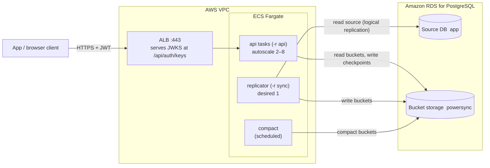

# Hosting PowerSync on AWS — Terraform example

A reusable Terraform deployment of a **self-hosted [PowerSync](https://www.powersync.com/) stack on
AWS ECS Fargate**, backed by **Amazon RDS for PostgreSQL** as both the source database and the sync
bucket storage. One `terraform apply` stands up the whole stack — network, TLS, the database, the
replicator + an autoscaling pool of API containers, secrets, and client-auth keys — and tears it
down just as cleanly.

Everything is prefixed by a **`deployment_name`**, so you can run several independent copies in one
AWS account and region side by side (e.g. `demo`, `staging`).

## Architecture at a glance



- **Network** — a dedicated VPC with public subnets (ALB + NAT + RDS) and private subnets (ECS tasks).
- **ECS Fargate** — one replicator (`-r sync`, single active instance), an autoscaling pool of
  client-facing API containers (`-r api`, behind the ALB), and a scheduled compaction job. The
  official public `journeyapps/powersync-service` image is pulled directly (no ECR mirror needed).
- **Amazon RDS (PostgreSQL)** — one instance hosting two databases: the **source** application
  database (`app`) and PowerSync's **bucket storage** (`powersync`). Logical replication is enabled;
  two least-privilege roles keep the source (read-only) and storage connections separate.
- **ALB** — HTTPS with an ACM-issued cert and a Route 53 alias; also serves the public **JWKS**
  PowerSync uses to validate client tokens.
- **Auth** — the JWT signing key is generated by Terraform; client tokens are minted locally
  (there is no deployed backend in this example).

> **Prefer MongoDB Atlas?** `infra/modules/atlas-cluster` is kept as a worked example of using Atlas
> (over AWS PrivateLink) instead of RDS — see the commented block in `infra/main.tf`. Note that,
> unlike RDS, Atlas allows only one PrivateLink service per region/project, so the `deployment_name`
> prefix does **not** let multiple Atlas-backed deployments share an Atlas project + region.

## Repository layout

| Path | What it is |
|---|---|
| [`infra/`](./infra) | The Terraform — everything above. See [`infra/README.md`](./infra/README.md) for prerequisites, setup, the apply/verify/destroy workflow, running multiple deployments, and how it works. |
| [`example-client/`](./example-client) | Companion toolkit — seed the database, mint a client token, run a minimal React client, and verify least-privilege scoping. See [`example-client/README.md`](./example-client/README.md). |

## Prerequisites

- **AWS account** — credentials for the target account, plus, pre-created out of band:
  - an **S3 bucket** for Terraform state (the `backend "s3"` bucket in `infra/versions.tf`),
  - a **Route 53 hosted zone** for your `base_domain` (Terraform requests the ACM cert + alias into it).
- **Tooling** — Terraform ≥ 1.10, the AWS CLI, `psql` (for the one-time DB bootstrap), and Node ≥ 20
  (for `example-client`).

## Configuration

Every account/DNS input is supplied as `TF_VAR_*` environment variables — nothing is committed.

```bash
cp .env.example .env     # fill in, then load it (direnv, or: set -a; source .env; set +a)
```

Required values: `account_id`, `base_domain`, `route53_zone_id`. Set `admin_cidr` to your
workstation IP to seed and run the client locally, and pick a `deployment_name` (defaults to
`powersync`).

## Quick start

```bash
# 1. Deploy (prerequisites + config above)
cd infra
terraform init \
  -backend-config="bucket=<your-tf-state-bucket>" \
  -backend-config="key=$TF_VAR_deployment_name/infra/terraform.tfstate"
terraform apply

# 2. Seed test data + run a client (see example-client/README.md)
cd ../example-client && npm install && npm install --prefix web
npm run seed          # create + load the demo `lists` table
npm run dev           # mint a token + open the React client
```

A successful run renders the synced rows in the browser — proving the full path
**Postgres → replicator → bucket storage → sync API → client**.

## AI disclaimer

This repo contains code generated with Claude, then reviewed and edited by hand.
