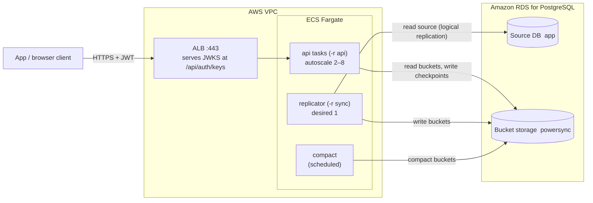

# Self-hosting PowerSync on AWS with Terraform

A reusable Terraform deployment of a self-hosted [PowerSync](https://www.powersync.com/) stack on
AWS ECS Fargate, backed by Amazon RDS for PostgreSQL as both the source database and the sync bucket
storage. One `terraform apply` builds the network, TLS, the database, the replicator, an autoscaling
pool of API containers, the secrets, and the client-auth keys. `terraform destroy` removes them.

A `deployment_name` prefixes every resource, so you can run several independent copies in one AWS
account and region at once (say `demo` and `staging`).

## Architecture at a glance



- **Network:** a dedicated VPC with public subnets (ALB, NAT, RDS) and private subnets (ECS tasks).
- **ECS Fargate:** one replicator (`-r sync`, single active instance), an autoscaling pool of
  client-facing API containers (`-r api`, behind the ALB), and a scheduled compaction job. Tasks pull
  the public `journeyapps/powersync-service` image directly.
- **Amazon RDS (PostgreSQL):** one instance holding two databases, the source application database
  (`app`) and PowerSync's bucket storage (`powersync`). Logical replication is on. Two
  least-privilege roles keep the read-only source connection separate from the storage connection.
- **ALB:** HTTPS with an ACM cert and a Route 53 alias. It also serves the JWKS that PowerSync uses
  to validate client tokens.
- **Auth:** Terraform generates the JWT signing key. Clients mint tokens locally; this example
  deploys no backend.

> **Prefer MongoDB Atlas?** `infra/modules/atlas-cluster` is a worked example of using Atlas over AWS
> PrivateLink as the data layer. See the commented block in `infra/main.tf`. One caveat: Atlas allows
> a single PrivateLink service per region and project, so on Atlas the `deployment_name` prefix does
> not isolate multiple deployments sharing a project and region the way RDS does.

## Repository layout

| Path | What it is |
|---|---|
| [`infra/`](./infra) | The Terraform. See [`infra/README.md`](./infra/README.md) for prerequisites, setup, the apply/verify/destroy workflow, running multiple deployments, and how it works. |
| [`example-client/`](./example-client) | Companion toolkit: bootstrap the database, seed it, mint a client token, run a minimal React client, and check least-privilege scoping. See [`example-client/README.md`](./example-client/README.md). |

## Prerequisites

- **AWS account** with credentials for the target account, plus two things created out of band:
  - an **S3 bucket** for Terraform state (set it in `infra/versions.tf`),
  - a **Route 53 hosted zone** for your `base_domain` (Terraform requests the ACM cert and alias into it).
- **Tooling:** Terraform 1.10+, the AWS CLI, and Node 20+ for the `example-client` toolkit (which also
  runs the one-time database bootstrap).

## Configuration

You pass every account and DNS input as `TF_VAR_*` environment variables. Nothing is committed.

```bash
cp .env.example .env     # fill in, then load it (direnv, or: set -a; source .env; set +a)
```

Set `account_id`, `base_domain`, and `route53_zone_id`. Set `admin_cidr` to your workstation IP so
you can bootstrap and seed the database, and pick a `deployment_name` (it defaults to `powersync`).

## Quick start

```bash
# 1. Deploy (prerequisites + config above)
cd infra
# set your state bucket in versions.tf, then pass the per-deployment key:
terraform init -backend-config="key=$TF_VAR_deployment_name/infra/terraform.tfstate"
terraform apply

# 2. Bootstrap + seed + run a client (see example-client/README.md)
cd ../example-client && npm install && npm install --prefix web
npm run bootstrap     # create PowerSync's DB roles, publication, and storage database (one time)
npm run seed          # create and load the demo `lists` table
npm run dev           # mint a token and open the React client
```

The synced rows appear in the browser, confirming the path from Postgres through the replicator,
bucket storage, and sync API to the client.

## AI disclaimer

This repo contains code generated with Claude, then reviewed and edited by hand.
